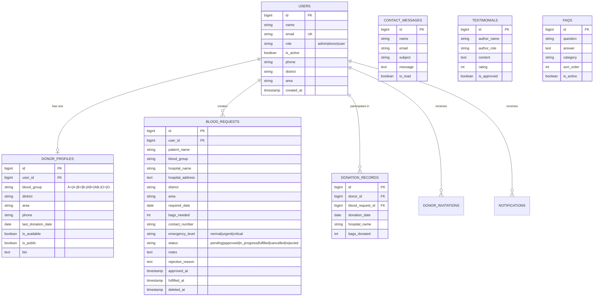

# 🩸 Blood Lagbe (ব্লাড লাগবে)

> **"Every Drop Counts. Every Donor Matters."**

A complete, production-grade, portfolio-level full-stack blood donation and emergency matching platform built for Bangladesh, ready for deployment on **Render** with PostgreSQL and Docker.

---

## 🌟 Overview

**Blood Lagbe** is a modern healthcare web application designed to eliminate delays in finding compatible blood donors during critical surgeries and medical emergencies. The platform connects patients and voluntary donors across all 64 districts of Bangladesh with automated matching, real-time status tracking, role-based authorization, and privacy-preserving contact protection.

---

## 📸 Screenshots & Showcase

| Homepage & Emergency Feed | Find Donors & Filtering |
|:---:|:---:|
|  |  |

| User Dashboard & Requests | Admin Analytics Panel |
|:---:|:---:|
|  |  |

---

## 🚀 Key Features

### 1. 🌐 Public Experience
- **Interactive Homepage**: Real-time platform statistics, dynamic blood group distribution counters, urgent blood requests feed, testimonials, interactive FAQ accordion, and quick action CTAs.
- **Find Blood Donors**: Multi-criteria search filtering by blood group (`A+`, `A-`, `B+`, `B-`, `AB+`, `AB-`, `O+`, `O-`), district (all 64 districts), area/thana, and availability status.
- **Blood Requests Feed**: Public feed highlighting emergency severity (Normal, Urgent, Critical) with patient privacy masking.
- **Donor Registration Workflow**: Streamlined registration with eligibility checks and explicit privacy consent.

### 2. 🔐 Authentication & Role-Based Authorization
- Three distinct access tiers:
  1. **Admin**: Platform oversight, user management, request approval/rejection, testimonial moderation, and FAQ authoring.
  2. **Donor**: Availability toggle, donation history logging, eligibility timeline reminders (90-day recovery cycle).
  3. **Regular User**: Post blood requests, track approval lifecycle, view notifications, manage profile.
- Built-in session security, rate limiting, and email verification support.

### 3. 📋 Blood Request Lifecycle
- Multi-step request submission (Patient info, Hospital/Ward details, Required date, Bags needed, Emergency level, Emergency contact).
- Administrative approval workflow with custom rejection explanations.
- Automatic location and blood group matching between active requests and voluntary donors.
- Status management: `Pending` → `Approved` → `In Progress` → `Fulfilled` / `Cancelled` / `Rejected`.

### 4. 📊 Admin Dashboard
- Live metric counters (Total Users, Donors, Total Requests, Pending Approvals, Fulfilled Requests, Critical Cases).
- Blood group inventory charts and monthly request volume analytics via Chart.js.
- Destructive action confirmation dialogs via Alpine.js.
- Contact message inbox with direct mailto reply integrations.

### 5. 🛡️ Security & Privacy
- **Contact Masking**: Donor phone numbers and sensitive patient contact details are restricted to authenticated users.
- **Medical Disclaimer**: Clear legal disclaimers reminding users that blood compatibility testing and cross-matching must be verified by certified healthcare professionals.
- **Full CSRF Protection**, strict server-side validation rules, SQL injection protection via Eloquent ORM, and safe error logging.

---

## 🛠️ Technology Stack

| Layer | Technology |
|---|---|
| **Backend Framework** | PHP 8.2+ / Laravel 12 |
| **Frontend Templates** | Blade Components & Layouts |
| **Styling & Design System** | Tailwind CSS (Custom Blood Red / Crimson palette) |
| **Interactivity** | Alpine.js & Vanilla JavaScript |
| **Database** | PostgreSQL (Render production) / SQLite (Local dev & test) |
| **Icons & Charts** | Lucide Icons & Chart.js |
| **Web Server / Runtime** | Docker (Alpine Linux, PHP-FPM, Nginx, Supervisor) |
| **Hosting Platform** | Render (Docker runtime + Managed PostgreSQL) |

---

## 📊 Database Architecture (Mermaid ERD)



---

## 💻 Local Installation & Setup

### 1. Clone the repository
```bash
git clone https://github.com/your-username/blood-lagbe.git
cd blood-lagbe
```

### 2. Install Dependencies
```bash
composer install
npm install
```

### 3. Environment Configuration
```bash
cp .env.example .env
php artisan key:generate
```

Configure your `.env` database connection (PostgreSQL or local SQLite):
```env
DB_CONNECTION=sqlite
# or for PostgreSQL:
# DB_CONNECTION=pgsql
# DB_HOST=127.0.0.1
# DB_PORT=5432
# DB_DATABASE=blood_lagbe
# DB_USERNAME=postgres
# DB_PASSWORD=your_password
```

### 4. Run Migrations & Seeders
```bash
php artisan migrate:fresh --seed
```

### 5. Build Assets & Start Development Server
```bash
npm run build
php artisan serve
```

Visit `http://localhost:8000` in your browser.

---

## 🔑 Demo Credentials (Seeded Accounts)

| Role | Email | Password | Access Privileges |
|---|---|---|---|
| **Super Admin** | `admin@bloodlagbe.com` | `password` | Complete Admin Panel (`/admin`) |
| **Donor (Demo)** | `rahim@example.com` | `password` | O+ Donor Profile & Availability Controls |
| **User (Demo)** | `user@bloodlagbe.com` | `password` | User Dashboard & Request Management |

---

## 🧪 Automated Testing

The project includes 38+ feature and unit tests covering authentication, registration, role authorization, blood request lifecycles, and donor management.

To execute the test suite:
```bash
php artisan test
```

Test coverage includes:
- `Tests\Feature\AdminTest`: Role security, admin access, approval and rejection flows.
- `Tests\Feature\BloodRequestTest`: Request creation, form validation, cancellation.
- `Tests\Feature\DonorTest`: Donor directory search, blood group filters, availability toggle.
- `Tests\Feature\PublicPagesTest`: Home, About, Contact, and `/health` monitoring endpoint.
- `Tests\Feature\Auth\*`: Registration, login, password updates, and session destruction.

---

## ☁️ Deployment to Render

The repository is configured for one-click deployment via **Render Blueprints** (`render.yaml`) and Docker.

Detailed deployment steps, troubleshooting, and production environment variables are documented in [RENDER_DEPLOYMENT.md](RENDER_DEPLOYMENT.md).

Quick summary:
1. Push this repository to GitHub.
2. In Render, select **New +** → **Blueprint**.
3. Connect your repository — Render provisions the web service and PostgreSQL database automatically.
4. The application builds assets, runs migrations and seeders, and exposes the health check at `/health`.

---

## 📄 License

This open-source project is licensed under the [MIT License](LICENSE).
